# Packet-capture examples

These synthetic, offline examples use `lmdebug pcap` (`context shark: Shark`) together with [lmplot](https://github.com/lmctl-ai/lmplot) and [lmdraw](https://github.com/lmctl-ai/lmdraw). Each program builds and analyzes its own synthetic capture and writes images plus deterministic CSV.

| Picture | Example | Command |
| --- | --- | --- |
|  | [dns latency](dns_latency.lms) | `lmctl autorun https://raw.githubusercontent.com/lmctl-ai/lmdebug/main/examples/pcap/dns_latency.lms` |
|  | [flow sankey](flow_sankey.lms) | `lmctl autorun https://raw.githubusercontent.com/lmctl-ai/lmdebug/main/examples/pcap/flow_sankey.lms` |
| 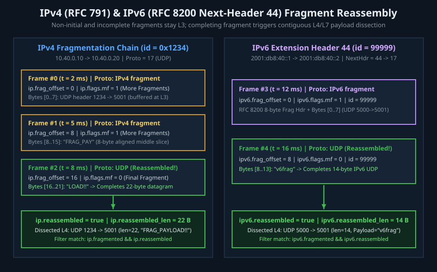 | [ip fragment reassembly](gallery/ip_fragment_reassembly.lms) | `lmctl autorun https://raw.githubusercontent.com/lmctl-ai/lmdebug/main/examples/pcap/gallery/ip_fragment_reassembly.lms` |
| 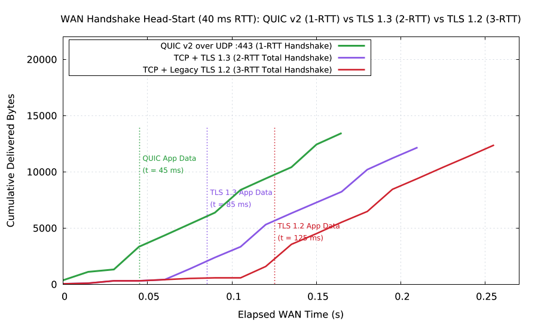 | [quic vs tls handshake](gallery/quic_vs_tls_handshake.lms) | `lmctl autorun https://raw.githubusercontent.com/lmctl-ai/lmdebug/main/examples/pcap/gallery/quic_vs_tls_handshake.lms` |
| 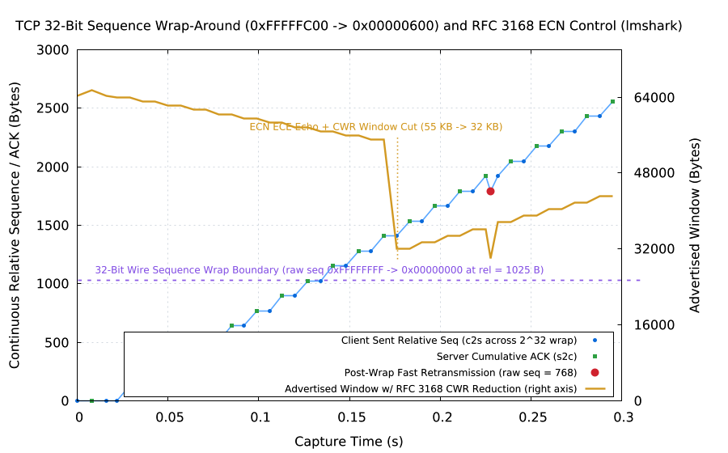 | [tcp seqwrap and ecn](gallery/tcp_seqwrap_and_ecn.lms) | `lmctl autorun https://raw.githubusercontent.com/lmctl-ai/lmdebug/main/examples/pcap/gallery/tcp_seqwrap_and_ecn.lms` |
|  | [vlan segmentation](gallery/vlan_segmentation.lms) | `lmctl autorun https://raw.githubusercontent.com/lmctl-ai/lmdebug/main/examples/pcap/gallery/vlan_segmentation.lms` |
|  | [header anatomy](header_anatomy.lms) | `lmctl autorun https://raw.githubusercontent.com/lmctl-ai/lmdebug/main/examples/pcap/header_anatomy.lms` |
| 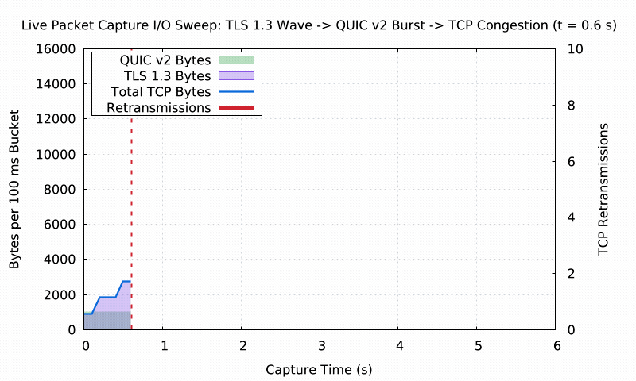 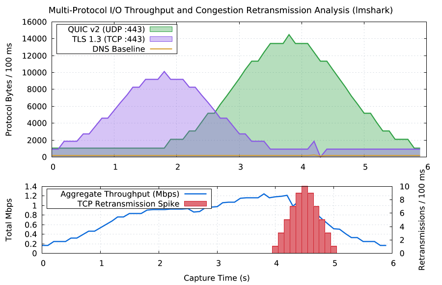 | [io traffic sweep](io_traffic_sweep.lms) | `lmctl autorun https://raw.githubusercontent.com/lmctl-ai/lmdebug/main/examples/pcap/io_traffic_sweep.lms` |
|  | [packet loss rtt histogram](packet_loss_rtt_histogram.lms) | `lmctl autorun https://raw.githubusercontent.com/lmctl-ai/lmdebug/main/examples/pcap/packet_loss_rtt_histogram.lms` |
|  | [port scan detection](port_scan_detection.lms) | `lmctl autorun https://raw.githubusercontent.com/lmctl-ai/lmdebug/main/examples/pcap/port_scan_detection.lms` |
| 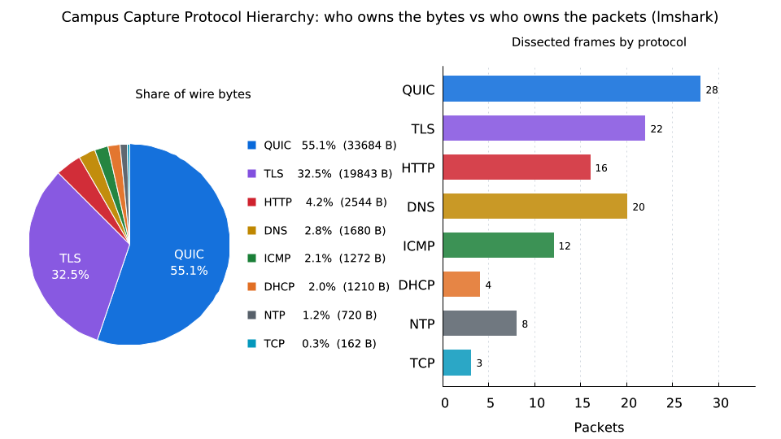 | [protocol hierarchy](protocol_hierarchy.lms) | `lmctl autorun https://raw.githubusercontent.com/lmctl-ai/lmdebug/main/examples/pcap/protocol_hierarchy.lms` |
| 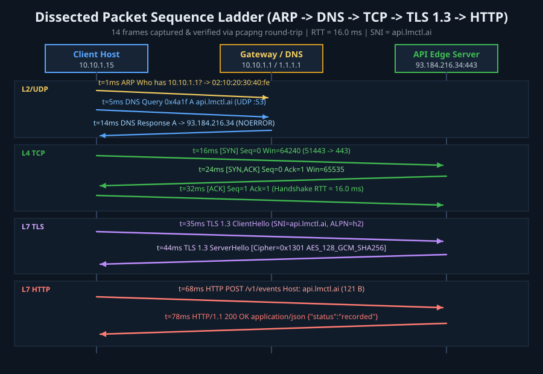 | [protocol sequence ladder](protocol_sequence_ladder.lms) | `lmctl autorun https://raw.githubusercontent.com/lmctl-ai/lmdebug/main/examples/pcap/protocol_sequence_ladder.lms` |
| 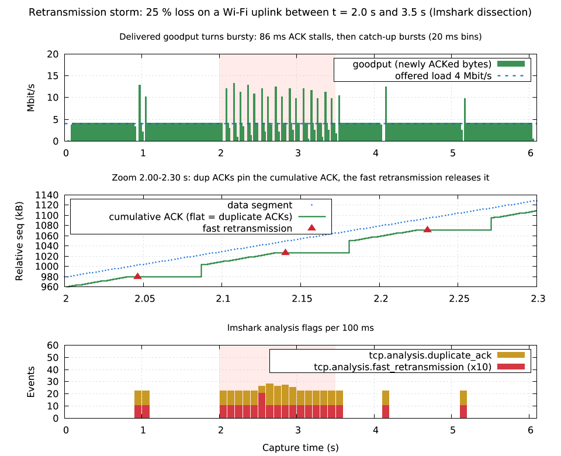 | [retransmission storm](retransmission_storm.lms) | `lmctl autorun https://raw.githubusercontent.com/lmctl-ai/lmdebug/main/examples/pcap/retransmission_storm.lms` |
|  | [rtt distribution](rtt_distribution.lms) | `lmctl autorun https://raw.githubusercontent.com/lmctl-ai/lmdebug/main/examples/pcap/rtt_distribution.lms` |
| 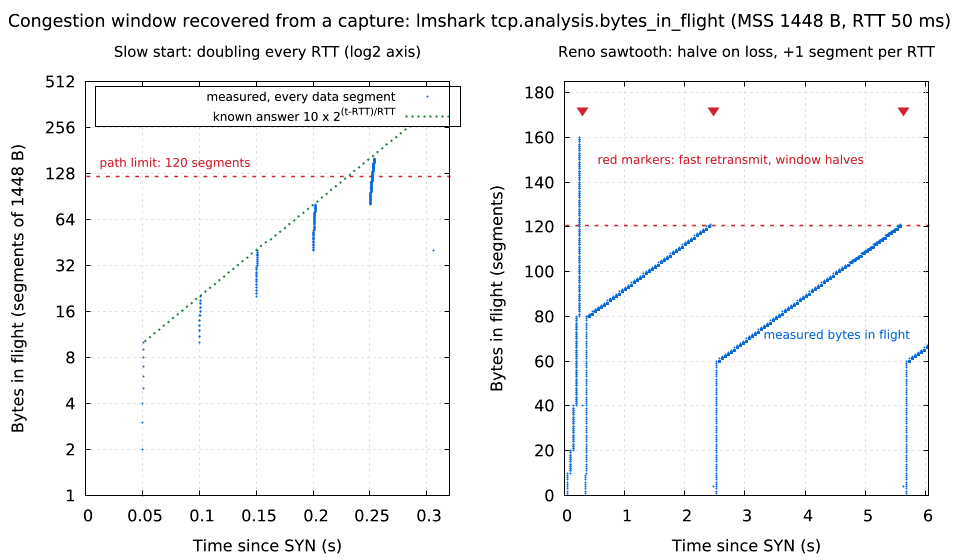 | [slow start cwnd](slow_start_cwnd.lms) | `lmctl autorun https://raw.githubusercontent.com/lmctl-ai/lmdebug/main/examples/pcap/slow_start_cwnd.lms` |
|  | [tcp handshake teardown](tcp_handshake_teardown.lms) | `lmctl autorun https://raw.githubusercontent.com/lmctl-ai/lmdebug/main/examples/pcap/tcp_handshake_teardown.lms` |
| 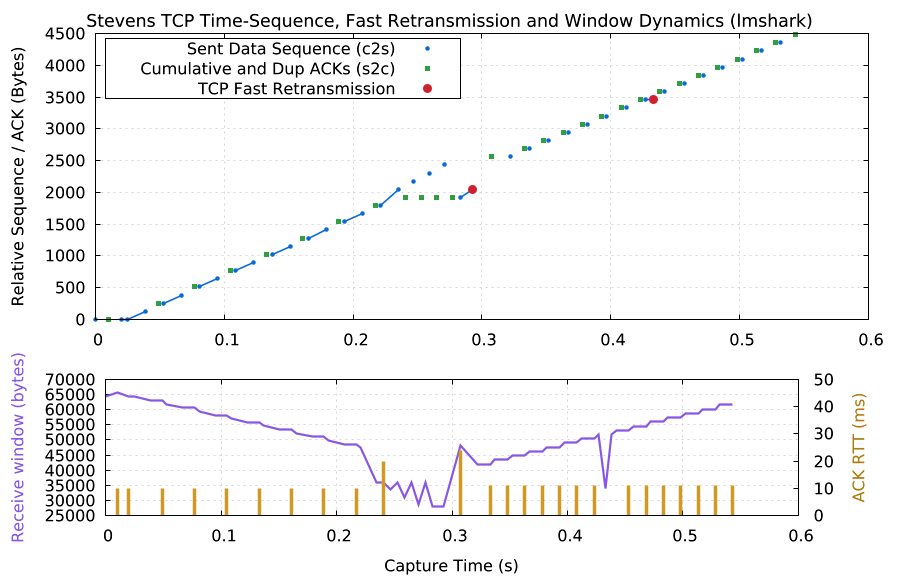 | [tcp stevens graph](tcp_stevens_graph.lms) | `lmctl autorun https://raw.githubusercontent.com/lmctl-ai/lmdebug/main/examples/pcap/tcp_stevens_graph.lms` |
|  | [tls version census](tls_version_census.lms) | `lmctl autorun https://raw.githubusercontent.com/lmctl-ai/lmdebug/main/examples/pcap/tls_version_census.lms` |
| 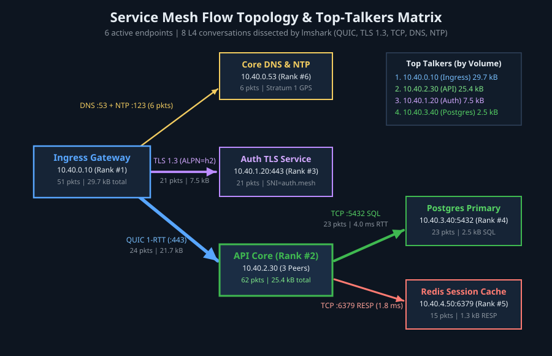 | [top talkers topology](top_talkers_topology.lms) | `lmctl autorun https://raw.githubusercontent.com/lmctl-ai/lmdebug/main/examples/pcap/top_talkers_topology.lms` |

The I/O sweep GIF uses the original `png_gif.py` helper embedded in its script; only Python standard-library modules are needed. GIF is the Graphics Interchange Format developed by CompuServe Incorporated; [format specification](https://www.w3.org/Graphics/GIF/spec-gif89a.txt).

## Live interface inventory (unprivileged)

| Picture | Example | Command |
| --- | --- | --- |
| 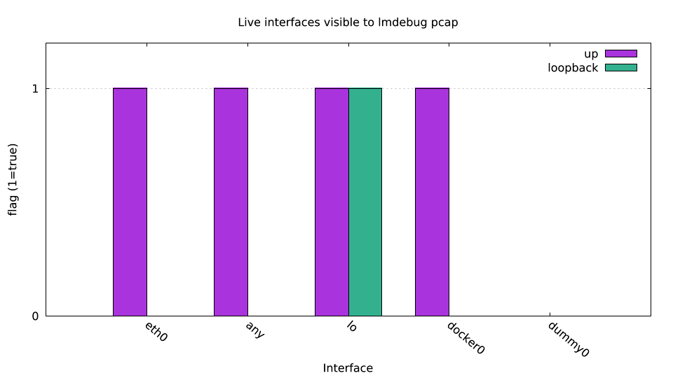 | [Interface inventory](live/interface_inventory.lms) | `lmctl autorun https://raw.githubusercontent.com/lmctl-ai/lmdebug/main/examples/pcap/live/interface_inventory.lms` |
